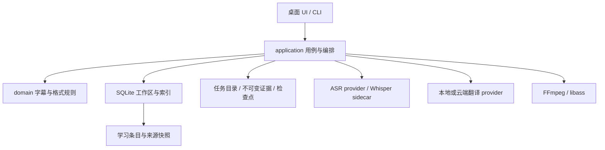

# 架构与目录约定

_核对日期：2026-11-12；离线基线 `cf23b87`，在线整合基线 `e06a9c6`。_

本文描述当前系统边界。逐次模块抽取与旧状态移入[清理前快照](archive/2026-11-11/architecture-before-review.md)，跨分支评估、Graphify 结果和同类工具见[系统回顾](system-review-2026-11-11.md)。2026-11-12 整合现有在线实现，不引入新的处理架构。

## 仓库组织

```text
Cargo.toml / src/             Rust library 与 CLI
  domain/                     字幕、语言、词表、样式与格式规则
  application/                任务、识别编排、翻译计划、工作区、学习用例
  infrastructure/             模型、媒体、SQLite、文件和网络适配器
  interface/                  CLI 与早期 Web Serve
src-tauri/                    桌面壳、IPC、平台凭据、下载、媒体传输
ui/                           TypeScript / Vite 前端
migrations/sqlite/            当前桌面数据库迁移
migrations/*.sql              早期 Postgres 迁移
scripts/ / examples/          构建、验证与诊断入口
assets/                       版本化词表与素材
docs/                        当前规范、验收、研究与历史
```

保留标准 Cargo 根布局。Tauri 和 CLI 复用根 library；平台界面通过应用用例调用处理能力。应用层目前直接依赖部分 infrastructure 类型，这是现有实现边界，不是完全解耦的 ports/adapters 架构。

## 目标桌面架构



`LocalTaskService` 管理任务与恢复，`JobRunner` 执行处理，`StageScheduler` 管理阶段资源；`LocalWorkspaceService` 管理字幕编辑、翻译写回与导出，`LocalRetranscriptionService` 管理候选，`LocalLearningService` 管理学习资料。样式、字体、烧录、词表分别由已有服务承担。`src-tauri/src/commands/` 只适配对应 IPC；桌面 `main.rs` 仍承担构造和部分命令，不能据已有拆分声称入口已完全收敛。

离线主链为媒体 → 音频块／检查点 → ASR run／timed units → 可编辑 cues → 翻译组／上下文 → 译文 → 回看／导出。音频块、字幕段、翻译组、HTTP batch 是不同对象。完整识别后发布人工工作区；云端可提前处理稳定前缀并保存私有结果，完整发布后核对输入和 revision 才复用。本地 Hy-MT2 在完整识别后独占设备阶段。默认 2 路 ASR、4 路云端请求，详见 [0052](decisions/0052-staged-concurrency-and-early-translation.md)。

## 数据边界

SQLite 保存任务索引、当前人工字幕、revision、来源／翻译依赖、词表、学习资料与非敏感设置。UUID 任务目录保存媒体派生物、冻结参数、原始识别、run／artifact 和恢复检查点。原始输入不随删除任务而删除；旧 `segments.json` 不覆盖已经编辑的 SQLite 字幕。

密钥保存在系统凭据库，不写入 SQLite、任务产物或文档。云端文本翻译和音频上传分别授权，本地失败不自动切换云端。模型与词典按需下载到设备，不打入 Bundle；macOS 完整包携带 FFmpeg、ffprobe、whisper-cli、llama-server。Windows 仍有独立打包／实机边界。

桌面本地播放通过只监听 loopback 的 token／Host／Origin 受限 Range 服务传输，和早期 Web Serve 产品外壳独立。保留媒体流式读取、唯一播放器和音频按需加载；见 [0054](decisions/0054-request-batching-and-loopback-media.md) 与 [0062](decisions/0062-editor-audio-demand-loading.md)。

## 核心数据约定

- 每个任务只有一个人工工作区，可关联多个完整或局部 ASR run。候选完成不自动覆盖字幕；采用核对范围、版本并事务写入。
- cue ID 稳定，原文、译文与来源关系分开。未知词时间不插值冒充精确时间；接缝处理见 [0060](decisions/0060-overlap-alignment-before-acoustic-selection.md)。
- 翻译冻结实际目标、上下文、provider 与版本；目标／上下文变更使相关译文过期，人工译文受保护。源／译 cue 继续对应，不因网络打包变成多对多映射。
- 结构编辑与撤销的来源、依赖、单调 revision 在同一事务恢复；会话 token 历史见 [0061](decisions/0061-transactional-structure-undo-metadata.md)。
- 字幕样式共用于 ASS、libass 预览和烧录；SRT 不承诺视觉样式，烧录会重新编码。
- 学习条目、来源例句和词典结果分层。任务删除后保留双语快照；查词／简明译义与字幕翻译、识别词表保持不同职责，见 [0032](decisions/0032-learning-reader-and-source-backed-collections.md)。

<a id="下一阶段架构已决策尚未实现"></a>

## 管线演进与实验边界

[0043](decisions/0043-layered-pipeline-and-task-scoped-asr-runs.md) 的数据分层、run／artifact、provenance／revision、语义组与依赖已经分批落地；旧[管线提案](archive/2026-11-11/pipeline-evolution.md)不再是待实施清单。当前主线仍含 Web Serve／Postgres 源码和默认依赖；[退役报告](legacy-web-retirement-impact.md)只完成分析，未执行隔离或删除。

在线实现从 `codex/online-desktop-integration`（`e06a9c6`）整合进入开发主线，包含原生采集、Rust 会话、Python 推理 worker 与独立字幕显示。稳定发行仍为 v0.1.3，不能把源码整合和已有试装当成新版已发布。在线采集 → CPU 草稿／Qwen 确认 → 独立翻译分组／修订 → 展示的时钟和状态，不等同离线任务的检查点／人工工作区。具体责任、性能证据和仍需讨论的选择见[系统回顾](system-review-2026-11-11.md)。

## 字幕编辑前端的渐进边界

前端保留一个播放器、一份字幕草稿与导航身份。`editor-session`、`editor-follow` 管理编辑／播放／锁定，`editor-cue-list` 管理虚拟列表，`editor-timeline-*`／`editor-waveform` 管理绘制与交互，`*-navigation` 管理各入口访问，`*-view` 管理 DOM 生命周期，`*-backend` 适配 IPC。异步返回核对当前任务／访问／代次；视图销毁不取消已经提交的数据库事务。

统一编辑器布局和交互以 [0058](decisions/0058-compact-editor-and-playback-follow.md) 为准；Rust 模块整理以 [0059](decisions/0059-desktop-command-and-repository-modules.md) 为准。`ui/src/main.ts`、Rust 服务与 `LocalDatabase` 仍集中较多协调，后续按真实变更和缺陷拆分，不以文件长度直接启动重构。各子模块历史说明与旧小节锚点见[原架构记录](archive/2026-11-11/architecture-before-review.md#字幕编辑前端的渐进边界)。
