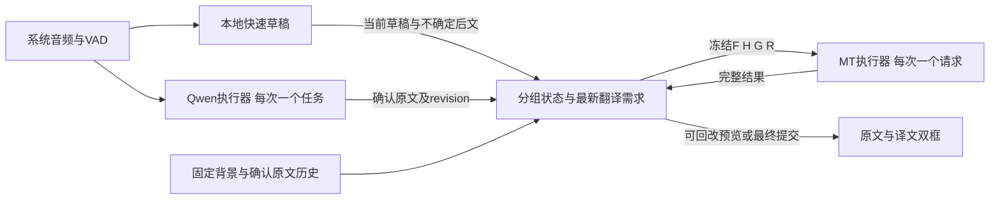

# Online 当前实现、模型与待验证边界

_核对：2026-11-16。当前开发主线，不等于 v0.1.3 稳定发行。_

## 当前状态

当前运行合同与固定文本质量测试分开：桌面仍按下文处理后文；固定校正 G/H、R 为空的 MT 忠实度结果单独保留，后继 runtime／DFlash 及预译接入另有实验合同。当前仅用五个已核准裁片回归，集合及排除规则见[当前评测](evaluation.md)。2026-11-16 用户授权固定本地 DFlash 配置并编译试装，云端后置，见[0080](decisions/0080-local-dflash-app-trial.md)。

在线实验与桌面接入已于 2026-11-12 整合到 main，旧分支计数和早期“尚未接入 App”不再描述当前状态。已有系统音频采集、控制面板、可修订原译文字幕和本机试装；新机 runtime／草稿模型准备、语义质量及稳定发行仍未交付。

| 层级 | 当前开发实现 | 仍未实现或未验证 |
| --- | --- | --- |
| 输入 | macOS 系统音频或同 worker 的因果 WAV 回放 | 实际整链最低系统版本需随选定 runtime 核验；采集 14.2+ 不代表 MLX 全链兼容 |
| 草稿 | 日语 1.7B 8bit＋完整 DFlash 包时单路 Qwen 预览；其他配置沿用 SenseVoice／Zipformer | 新机 runtime 安装闭环；DSpark 不作为试用配置 |
| 确认 ASR | Qwen3-ASR 1.7B MLX 8bit 默认；DFlash 路径沿用 VAD 定稿，其他 Qwen 可选 | Qwen 离线文件 provider、native runtime 迁移未实施 |
| 在线 MT | Hy-MT2 1.8B Q4_K_M 默认；Index-Translate 2B Q4 可选，均由 App 管理本地 llama-server | 在线面板没有 DeepSeek／Gemini 云端入口；离线已有云端文本 provider 不等于在线已接入 |
| 状态与调度 | F／H／G／R、源时钟分组、revision、需求合并、阶段交错、共同停止预算；DFlash 音频块／target／draft KV 复用 | 原生采集到上屏的完整质量验收、连续正确中文两秒及长时资源 |
| 保存 | 在线事件在会话内显示，不写入离线人工工作区，当前无录音入口 | 显式开启录音、结束后手动离线精修是 0065 已确认方向，尚未实现；自动校正触发和失败音频持久恢复仍待设计 |

模型下载、固定 revision、逐文件大小和 SHA-256 以[模型目录](../src-tauri/src/model-catalog.json)为准；分类与下载见[0078](decisions/0078-model-categories-and-qwen-packages.md)，默认选择见[0079](decisions/0079-qwen-17b-8bit-online-baseline.md)。不在本文维护另一份可能漂移的型号／量化清单。

[13 分钟回归](qwen8-online-regression-2026-11-14.md)证明当时双模型 worker 在两段开发材料上完成运行与关联完整性检查，仍发现语义错误，不代表准确率或真实上屏验收。[Voxt 调查](voxt-local-asr-review-2026-11-14.md)提供实时预览、资源约束和交付参考；后继 Python DFlash 适配、音频缓存及本地试用接入见[路线图](roadmap.md)及[评测合同](evaluation.md)，没有迁移其 native runtime。

## 有效合同与历史入口

以 [0076](decisions/0076-source-driven-retranslation-and-stage-admission.md)及下文合同为准，0079 更新默认确认模型，0080 更新指定本地试用配置的 ASR 执行器；MT 输入、分组与资源互斥不因此改变。0076 已取代 0072／0073／0075 中冲突的历史、后文和调度规则；0074 的原译文关联显示继续有效。

2026-11-02 至 11-09 的旧分支事实、Whisper／Qwen 候选清单、runtime 试跑顺序和事件流提案已[归档](archive/2026-11-14/online-asr-proposals-before-baseline.md)。WS／SS／CPP 工具仍供历史复现及共用诊断；不是当前生产 provider，也不是每轮回归的前置矩阵。旧模型、锁文件、私人媒体和人工证据不因归档而删除。

早期事件流／完整单一 owner 的具体提案见[历史原文](archive/2026-11-14/online-asr-proposals-before-baseline.md#事件流与单一状态所有者具体提案尚未实施)，不将其全部记为已落地。

## 当前合同：重译与流水线调度（2026-11-11 已实施）

用户已确认按输入与状态合同、调度拆分、SenseVoice后文与收口的顺序实施。本节收敛上一轮结构提案；实施记录见下，App更新仍单独验收。与旧提案不同，本版不把“最终ASR队列始终优先”和“后文必须全部Qwen确认”预设为普遍规则，目标是提前生成可读译文并减少执行等待。

### 技术边界

- 0076 首版保留本地第一遍、Qwen整段第二遍及已选MT；0080 指定试用配置由同一 Qwen＋DFlash 执行器产生可回改预览／VAD 定稿，其他配置延续双模型。没有训练同传模型或迁移 native runtime。
- 支持增量解码不等于需要更强算力：状态复用可能减少重复工作，但能力、质量和资源占用取决于模型／实现。KV由runtime管理；跨轮检查点、回退等能力是否可用由backend决定，应用不手工拼接Qwen与MT的KV，更不能在不同模型间共享它们。
- 本机mlx-qwen3-asr 0.4.4已有Session.init_streaming／feed_audio／finish_streaming及transcribe_async。这是将来的接口候选，不是本版前置；async只解决阻塞调用组织，不保证GPU推理加速。
- 保留现有采集、模型生命周期、会话级设备许可、失败隔离和双框。只拆开已有阻塞调用的执行责任，不建设新的provider框架、Agent记忆系统或大型消息总线。

参考：[SimulStreaming](https://aclanthology.org/2025.iwslt-1.41/)、[2024流式beam检查点](https://arxiv.org/html/2407.11010v1)、[AliBaStr-MT](https://arxiv.org/html/2508.13358v1)、[Pinch-AST](https://aclanthology.org/2026.iwslt-1.30.pdf)。其中训练式READ/WRITE、decoder检查点和LoRA噪声／前缀训练不冒充现有轻量MT可直接获得的能力。

### 输入合同：固定背景＋H／G／R

| 信息 | 内容与来源 | 更新及使用规则 |
| --- | --- | --- |
| 固定背景F | 用户给定的节目类型、话题、人名／术语、翻译方向 | 会话开始时固定，沿用现有scene／词表入口；不由模型总结或自主更新 |
| 历史H | 位于G之前的已确认原文，按完整源单位／组保留 | 机械FIFO，最多8组／2000原文字符，按完整组淘汰；默认不输入历史译文 |
| 当前待译组G | 当前组的最新原文；Qwen已确认部分优先，其余可用本地草稿预译 | 唯一应翻译的覆盖范围；每次请求记录实际源段ID及revision |
| 后文R | G之后已经听到的连续后文原文；可来自SenseVoice，后续可被Qwen修订 | 取紧邻G的连续后文，不跨无文本缺口，上限先沿用500字符；明确是不确定参考，不是模型预测的未发生内容，不计入本次译文覆盖 |

F在初始稳定提示中，H／G／R按各MT后端支持的模板隔离，不为缓存命中强行违背模型训练模板。只输出G的译文。H／G／R通过音频范围和源段身份去重，不用模糊字符串拼接或伪造词级时间。

这是用户已确认的、相对旧8组完整源译历史对的输入变化。理由是简化职责、限制旧译文自我传播，不声称原文历史一定比源译历史更准确；此前实验没有证明删除历史译文稳定改善质量。固定背景也不能替代刚才发言的指代信息，因此保留短H，不引入动态摘要、实体状态或自主检索。2000原文字符与当前2000源译字符的实际覆盖不同；质量对照必须保存实际输入，不能因预算数字相同就称上下文等量。

H按原文是否确认维护，而非按MT是否成功维护。即使前组MT尚未返回或已经失败，已确认的前文仍可供后组理解；展示历史、MT提示历史、任务队列各自有界，不互相替代。

### 数据流与执行责任

Qwen Session仍由专属线程创建和使用；MT使用现有本地服务。两阶段逻辑上可独立在途，采集、CPU草稿、分组和显示不等HTTP完成。状态归约保持短且序列化，分组不能在take的副作用中临时决定；重用现有Retranslation作为状态边界，不先要求新增独立服务。

当前实现的“流式”指连续音频输入、跨区间的原文／译文事件持续推进，不表示两个模型都进行 token 级流式返回。Qwen 按音频快照完成一次识别后发布原文，MT 客户端以 `stream=False` 接收完整译文。默认 StageAdmission 让 Qwen 与本地 MT 在共享 GPU 上按任务交错，MT(A) 期间采集和 CPU 草稿仍可推进，Qwen(B) 需求等待执行机会；不是先完成整个会话识别再统一翻译。已有 `overlap` 候选允许一条 Qwen 与一条 MT 同时在途，先前一次容量对照未改善最终译文延迟，因此没有设为默认。后继缓存实验保持这个互斥合同，不混入 batching 或并发改动。

物理执行需区分资源：独立设备／远端MT可以直接交叠Qwen(B)与MT(A)；本机共享GPU不预设并行必然更快。设计支持一条ASR任务与一条MT请求在途的候选模式，最小实现保留任务级交错作为可用路径。是否在本机默认同时执行，最后只做一次针对吞吐／队列年龄的比较后决定，不扩并发参数矩阵，也不新增用户配置。不得把串行交错称为已完成物理并行。

### 调度规则：推进最旧待译组

状态层维护最终ASR FIFO、按音频顺序的最终MT需求，以及当前组最多一个最新预译需求；需求不是提前冻结的一串HTTP请求。MT真正获得执行机会时才冻结F／H／G／R，未开始的旧版本被覆盖。当前会话最多一个MT生成，不因草稿频繁更新再排FIFO。

建议在以下语义事件上安排执行机会，不先改变现有数值阈值：

1. 当前组获得新的Qwen确认原文时，允许该组先完成一次最新翻译，不必先识别完所有更晚音频。已经可完成的最旧最终MT不应永远排在后续Qwen任务之后。
2. 最终ASR仍保持音频FIFO。只在最旧组获得最新翻译机会后继续推进后续识别，避免一个组的草稿反复占满资源；MT未到既有最短刷新间隔时，继续做有用ASR而非空等。
3. 仅SenseVoice变化时，更新最新预译需求，机会执行；不因R每次变化都立即启动一个请求。R只变化的低优先级预译让位于待处理最终ASR／最终MT，最新R总会被下一次实际请求读取。
4. 任务已经执行时，新输入只合并到状态；不在每个revision都取消重启。首版不接token级抢占或主动取消，短任务完成后交接；单次异常长生成仍可能阻塞共享GPU，这一限制明确保留，不用“异步”掩盖。
5. 后续如确需治理在途长尾，再接已验证的单请求取消；取消代价、服务端释放与剩余会话预算单独处理，不直接沿用研究2秒预算。

本机串行路径的例子：旧顺序可能是Qwen(A)→Qwen(B)→Qwen(C)→MT(A)。新顺序允许Qwen(A)→MT(A，参考SenseVoice(B))→Qwen(B)；如果资源支持并行，则Qwen(B)可与MT(A)同时在途。跨组交叠主要减少后续等待和积压，不会自动消除A自身识别后才能生成最终译文的依赖。

### 预译与收口：不同的触发条件

预译在G尚未封口或尚有草稿时即可进行，不把额外语义等待当成开始MT的条件。现有代码已有草稿翻译，本版改的是其执行机会、参考输入和状态转换，不宣称第一次增加预译能力。

当G成员源文全部Qwen确认，且分组策略已经确定提交边界时，才有最终提交资格。提案不额外等待R也被Qwen确认：R可以在最终请求中仍是不确定参考；它不进入当前覆盖和当前源文确认条件。R到达／变化不回改已经锁定的白字，也不让已启动最终请求无休止重启。这是需要明确接受的质量／延迟取舍；可能因不可靠R导致误译，不能包装成纯正确性修复。

分组时长、字符数、停顿及原有兜底值首版不另选一套；将“边界如何决定”与“任务何时执行”分开。现有日语句末规则把Qwen后文当作条件的部分需要专门调整：不能在外层宣布R不必确认，却在句末分支仍暗中等待它。建议在保持现有范围／标点规则的基础上，让已观察到的R提供参考证据，不将R最终确认当普遍屏障；不新增日语特词清单。此行为变化必须和错误／退化实例一起验收，不能保证所有句子都能更早安全锁定。

若完整有效提示、解码配置和模型均相同，最近一次完整预译可复用并转为最终状态，不因蓝→白再次生成；原文或参考变化则重新翻译。只做完整输入等价复用，不做语义相似命中或手工KV续接。缓存仍有界，白字提交仍逐组一次；错误、截断、取消的部分内容不能命中。

固定背景与稳定历史尽量构成公共输入前缀，前缀缓存交给现有MT runtime。改动R或G后只能复用仍完全相同的输入前缀，不能继续使用基于旧源文生成的目标KV。SSE可帮助观察输出／取消，但不是一边生成一边接收新源文的协议；首版仍先校验完整返回再发布。

### 展示与结束会话

原文仍Qwen完成即锁定，译文仍在同框中保留白色前文和蓝色可变部分。原文显示最新确认版本，旧蓝色译文允许暂时滞后并保留实际输入revision；新结果到来前不清空，也不把落后版本变成最终译文。可见范围继续按关联音频选择完整单位，不按屏幕长度回调识别或翻译。

停止时先关闭采集、flush并封口剩余范围，禁止新预译，优先完成最终ASR和最终MT；所有剩余请求共享外层排空剩余预算。沿用现有失败隔离和显式未完成范围，不用延长120秒单请求去绕开30秒会话排空，也不自动上传、录音或进入离线精修。

### 实施切分与验收

1. **输入及状态合同。** 先实现F／H／G／R的明确来源、版本与覆盖；将分组从取任务副作用移出，保证同一源事件流的成员划分不因MT执行快慢改变。机械原文历史与旧源译历史是明确版本差异，不混成一次“提示优化成功”。
2. **执行和调度。** 分开Qwen／MT阻塞调用，仍各一在途，复用已有模型生命周期；实现最旧待译组的执行机会及最新需求合并，先不接主动取消或自管KV。
3. **前后文及收口。** 接SenseVoice的R，核对G／R不重叠，移除R必须Qwen确认的隐式屏障；完整提示相同可复用，收口不重复生成，不因迟到结果改白字。
4. **最小验证。** 先用手写事件验证不饥饿、边界独立、需求合并、源范围与版本、历史、EOF、唯一提交及失败隔离；再以固定真实回放比较旧／新整体方案，不先搜索chunk／超时／历史组合。新三段输入不自动继承旧语义结论。
5. **资源与体验验收。** 本机重任务交错与一对并发只做一个具体对照，决定是否启用物理并行。观察首次可读译文、最终译文等待、否定／指代／专名错误、回改量、队列年龄和整体RTF；调用更少、NE更低或结构测试通过都不能单独宣称质量／延迟改善。通过后再讨论覆盖安装。

本版已确认的选择：H默认仅原文；R不确定时仍可用于最终请求且不强制等待Qwen确认；共享GPU并行是否启用由一次容量验证决定。其余模型替换、Qwen增量窗口、训练式同传和在途抢占留后继，不作为本版前置。

### 实施记录

2026-11-11第一步已落地：MT历史按已确认原文维护，可从尚未翻译的前组读取，最终翻译失败仍保留可靠原文；当前G与后续原文不进入H。退休组原文按8组／2000原文字符有界保留，不保存旧译文为提示历史；两后端对空目标上下文只渲染原文，保留已有研究工具显式源译对输入能力。新增源文历史与prompt合同回归，154项Python及fmt／diff通过。模型、分组／调度与App此阶段未改，性能与语义质量不因输入合同通过而认证。

第二步与第三步已接入worker：原文／时钟事件决定分组，`take`只冻结输入和保留任务。候选范围关闭与真正封口分开；截止前到达的原文可细分候选范围，封口后成员不再改变。R可含连续SenseVoice草稿，记录实际包含的源段revision与不确定标记，不跨空白缺口、不触发已锁定译文重译。日语句末事件名由`japanese_sentence_with_final_lookahead`改为`japanese_sentence_with_lookahead`，表示不再强制后文确认；旧冻结研究产物保持原样。

Qwen与MT分别在专属线程执行，各最多一任务。当前默认共享设备任务级交错：最旧组最终MT／新增确认原文的一次翻译机会先于更晚ASR，仅草稿更新让位于等待中的ASR；资源未获准前不冻结旧请求。容量候选允许各阶段一任务交叠，仅供一次比较，未新增用户配置。事件写出移到状态锁外，退出时停止预译；最终ASR失败可解除采集线程的队列背压。166项Python、3项展示回放、16项UI状态回归及fmt／diff通过；这些证明状态合同，不代表模型质量和端到端延迟已经改善。

固定素材容量对照已完成，保留交错默认：并发降低ASR排队，但增加单次计算耗时，未改善最终MT等待；两模式均36源段／19最终组完整覆盖，2/3局部语义锚点仍失败，故未覆盖安装App。条件、指标及限制见[evaluation](archive/2026-11-14/evaluation-before-confirmed-text.md#下一版任务交错与一对并发容量对照2026-11-11)。这不是旧App／新App的整体E2E胜负，也不把后验锚点当完整人工gold。

共同排空预算已接入：桌面owner在临时控制目录原子发布一次截止时间，仅含时间元数据、会话结束清理；worker读到后转为单调时钟，EOF仅可缩短预算，不重新加30秒。停止预译，新ASR／MT检查剩余预算，HTTP超时取剩余时间，超时后返回不入缓存、不提交白字。采集退出不重置owner倒计时。已经执行的MLX／HTTP仍不可主动抢占，由现有owner的30秒硬停止兜底；没有增加请求级取消协议。170项Python与3项Rust会话测试、两套fmt及资源清单／diff检查通过；预算本次为确定性／模拟会话验证，不冒充真实卡死模型的30秒故障注入。打包清单已包含新增模块，未构建／覆盖安装App。
