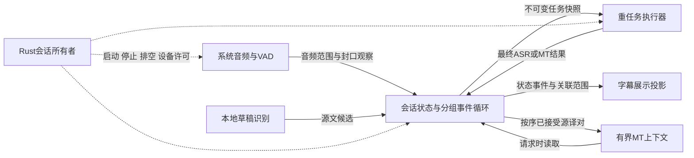
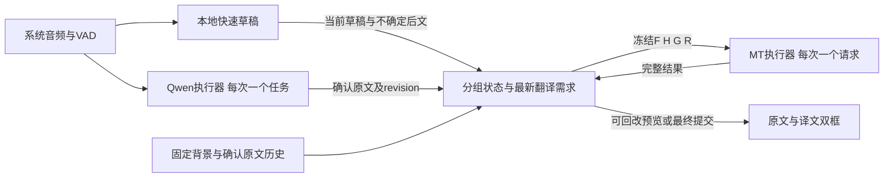

# Online ASR 当前计划与模型清单

_更新：2026-11-07。[0074](decisions/0074-paired-caption-reading-and-window-toggle.md)将显示改为原译文关联范围＋少量原文实时尾部，控制按钮切换显示／隐藏；不改变模型与MT提交策略。[0073](decisions/0073-local-index-translation-and-paired-context.md)新增Index本地翻译选择、完整源译历史对及词表／场景提示；沿用0072分段与等待。日语MT跨短停顿重译及保守句末＋最终后文提交见[0072](decisions/0072-japanese-semantic-block-retranslation.md)，3s／8s为首版兜底，质量未验收；其他语言仍沿用[0070](decisions/0070-online-independent-prefix-commit.md)默认1.2s／4s。双框显示软窗口与语义块分开，ASR不变。会话底座见[0067](decisions/0067-online-session-owner-and-system-audio.md)；云端与轻量MT仅调查，vLLM继续搁置。_

本文是 online 分支的当前入口，决策见 [0063](decisions/0063-online-two-pass-model-selection.md)。2026-10-02 至 10-05 的 WS／SS／CPP 结果保留为历史证据，不再按旧矩阵继续选型。本文的“保留／新增／退出”是实验范围，不代表桌面模型目录或磁盘文件已修改。

## 分支现状与范围

2026-11-02已在main基线上准备 `codex/online-desktop-integration` 合入研究历史；产品接入方向见[0065](decisions/0065-online-desktop-integration.md)。下文分支计数是此前整理时点，不是当前整合分支状态。

整理前分支为 `codex/online-asr-experiments`，HEAD 为 `bd19b55`，工作区干净且与对应远端引用一致。相对本地 `origin/main`，分支独有16个提交、main独有234个提交，共同基点为 `fbbbcd95`。当时未合并main且未改写历史；分支中的旧桌面进度不能当作当前 main 状态。0045／0046 与 main 上同编号的不同 ADR 重号，引用必须带文件名；本次使用0063避免再占用主线既有编号。

已有能力：三套 Whisper 回放、独立媒体时钟、VAD／尾部动作实验、事件与资源日志、串行 MT 重放。最新旧报告记录39项 Python 回归及真实模型回放；本次没有重跑。Qwen MLX整段识别及串行Hy-MT2链路已跑通，见[记录](qwen-mlx-smoke-validation.md)；SenseVoiceSmall也已完成sherpa-onnx整段ASR→MT对照，见[记录](sensevoice-smoke-validation.md)；本地two-pass独立CLI已接通日语SenseVoice草稿和英语Zipformer草稿→Qwen1.7B→Hy-MT2，见[记录](two-pass-smoke-validation.md)；正式采集／App／云端尚未接入，vLLM继续搁置。

CLI／隔离产物继续独立于 offline 任务、SQLite 与 GUI；完整录音可另交全文 offline 精修，online 的段级定稿不等于人工核准资料。新方案仍须记录模型／runtime revision、配置、输入摘要与失败，但不沿用旧三 backend 全矩阵作为前置门禁。

## 模型清单

| 模型 | 本轮用途与范围 | 当前状态 |
| --- | --- | --- |
| Whisper small | 轻量识别对照，可评估第一遍草稿 | 旧受控实验已跑；不自动视为新 two-pass 已接入 |
| Whisper medium | 质量／速度中档对照 | 桌面目录已有；新 online 配置未验证 |
| Whisper large-v3-turbo Q8_0／large-v3 Q5_0 | 用户确认保留这两个large系列档位，与small／medium并存 | App目录移除其他large档位尚未实施；Qwen满意后可进一步削减 |
| Whisper tiny／base、未量化 large-v3 | 退出当前主动选型清单 | 仅保留旧实验、冒烟用途和已有文件，不删除 |
| SenseVoiceSmall | 第二遍整段识别候选；支持中／粤／英／日／韩 | sherpa-onnx FP32／CPU单线程已跑通18s／60s ASR→MT，质量供用户对照 |
| Qwen3-ASR 0.6B／1.7B | 第二遍整段识别主要候选 | MLX整段ASR→Hy-MT2已跑通，见[记录](qwen-mlx-smoke-validation.md)；vLLM按用户要求暂时搁置 |
| streaming Zipformer | 本地原生流式草稿 | 中／英／韩公开样本均已按时钟跑通，英语已接two-pass；不支持日语组合 |
| Silero VAD 6.2.3 | 因果起停声检测，触发第二遍音频段封口 | online lock 已固定6.2.3；本次不升级 |
| Hy-MT2 1.8B Q4_K_M | 唯一本地翻译候选 | 沿用已有 runtime 与权重；用户所称1.7B在此按正式名称1.8B记录 |
| Hy-MT2 7B | 退出本轮本地选型 | 已跑历史实验；不继续优化或要求完成7B盲评，不卸载已有文件 |
| 云端 ASR／MT | 本地质量或 E2E 不合适时的对照／替代 | 已梳理Gemini／Qwen3-ASR／Groq价格；本轮无新调用，不继承过去的单次上传授权 |

Zipformer 是模型架构，sherpa-onnx 是推理框架；语言范围依赖具体 checkpoint，不是框架天然限制。SenseVoice 支持日语是已公布能力，日语较弱是待验证假设。Qwen 0.6B与1.7B已在同输入上跑通，用户目前更偏好1.7B质量；SenseVoice新增对照不自动改变该偏好，也不冒充gold评测。

### Whisper large-v3 可选格式（2026-11-02核对，尚未选定）

turbo与量化是独立维度：large-v3约1.55B、32层decoder；turbo约809M、4层decoder，是剪枝后微调模型，不是large-v3的量化别名。未量化常用F16，F32可用于数值对照，不作为本轮常用部署档；F16仍不是无限精度。

以下为whisper.cpp常用候选，体积是十进制下载大小，不是推理峰值内存：

| 模型／格式 | 约体积 | 获取与比较意义 |
| --- | --- | --- |
| large-v3 F16 | 3.10GB | 上游现成文件；保留完整decoder，作为质量／量化对照 |
| large-v3 Q8_0 | 约1.66GB，实际以转换文件为准 | 可从原模型转换；本次核对的上游文件目录未列现成v3 Q8_0，不能误用v2 Q8_0 |
| large-v3 Q5_0 | 1.08GB | 上游现成文件，项目目录已有；压缩权重但仍保留32层decoder |
| large-v3-turbo F16 | 1.62GB | 上游现成文件；区分turbo结构变化与量化影响 |
| large-v3-turbo Q8_0 | 874MB | 上游现成文件，项目目录已有；值得评估的速度／体积折中 |
| large-v3-turbo Q5_0 | 574MB | 上游现成文件，项目目录已有；更省权重存储，质量／速度仍须实测 |

whisper.cpp当前上游转换工具还列出Q4_0／Q4_1、Q5_1及Q2_K至Q6_K等格式，但不代表项目固定runtime均已验证，也不代表都有现成权重。本轮不扩成全量化矩阵。Q8／Q5是分块量化格式，不是所有张量都严格占8／5bit，也不能仅凭文件更小推断必然更快或质量无损。

MLX可用F16／F32及其自身分组量化格式（上游提供4bit转换）；faster-whisper／CTranslate2可用FP16、INT8及INT8_FLOAT16等计算类型，实际取决于设备。GGML Q8_0、MLX 8bit与CTranslate2 INT8不视为同一产物或相同数值实现，文件不能跨runtime直接互换。turbo不保证每段日语都弱于完整v3，完整v3也不保证必然胜出；需固定输入和解码设置比较。

后续用户确认large系列仅保留turbo Q8_0与非turbo Q5_0，其他格式退出App目录；small／medium继续保留，已有文件不自动删除。上述完整格式表用于解释选择，不再要求新增F16对照。实际App目录改动待单独实施。

### SenseVoice公开版本

SenseVoice论文包含Small和Large；Large的研究指标不等于权重已经公开。当前官方仓库公开的是SenseVoiceSmall；维护者2026-07-15明确表示Large checkpoint尚未发布且无可靠时间表，本次未找到后续官方Large发布。Small的ONNX、INT8、GGUF等是同一基础模型的部署／量化转换，不是另一种容量型号。本轮保持Small，不为等待Large阻塞探索，也不把Fun-ASR等不同家族当成Large别名。

### Silero 是否升级

截至2026-11-02，公开 PyPI 最新包仍为6.2.3，与 `experiments/online/envs/simulstreaming/uv.lock` 一致；pyproject 是 `>=6.2.3`，复现仍使用 `uv sync --locked`。旧实验 JIT 模型 SHA-256 为 `e1122837f4154c511485fe0b9c64455f7b929c96fbb8d79fbdb336383ebd3720`。新 ONNX／sherpa 路径需另固定资产版本、摘要和状态处理，不能只复用包版本号。

桌面目录的 `ggml-silero-v6.2.0.bin` 是 whisper.cpp 使用的另一种格式／资产，本次不替换。没有证据表明旧长静音恢复缺陷由 Silero 模型版本导致；换 VAD 不能代替修正音频队列与调度。后续只有明确缺陷或新版本收益才安排有界配对验证。

## 第一阶段 two-pass 行为

后继pipeline采用[0066](decisions/0066-online-retranslation-groups.md)：译文按跨VAD活动组整体重译，ASR定稿不直接提交译文；CLI已接入草稿、收口及全组最终revision检查。正式采集与App尚未接入。

用户已确认第一遍必须本地，允许滚动窗口形成可回改草稿；定稿可本地／云端。当前CLI实现、模型分工、云端价格与局限以[0064](decisions/0064-local-drafts-and-segment-finalization.md)及[链路记录](two-pass-smoke-validation.md)为准。

持续音频同时进入完整录音保存、第一遍草稿识别及因果 VAD。第一遍负责实时上屏；VAD 提供起声／停声信号，第二遍对已封口的完整音频段重新识别，替换对应活动段草稿。第二遍以原始音频为依据，初期不把第一遍文字作为强提示。

这里的“整段”是一次 VAD／长度策略封口的音频段，不是等待整个会话结束。第一阶段不做第二遍流式；快慢模型同时流式的方案留待整段延迟实测后再决定。日语当前先用SenseVoiceSmall CPU滚动草稿，Whisper及Qwen MLX流式接口仍是后续对照候选，不把Zipformer作为跨语言必需组件。

VAD 边界、ASR 定稿、翻译语义组是不同事件。停顿可以触发第二遍，但不自动保证句意完成，也不要求第一遍每次短停顿清空状态。第二遍定稿后再按句意／上下文和等待上限送翻译；草稿提前翻译及回改成本后置。

长独白需最大段长和有限重叠；pre-roll、尾部静音等待、长段切点、跨段上下文和去重策略尚待实测确定，不在文档中假称已有默认值。完整录音与有限 ASR 工作上下文分离，分段记录原媒体坐标；不能要求起声后先解码全部历史静音。旧长静音回放仍可作为回归素材，但不必修完所有旧 adapter 才接新模型。

段级定稿及译文绑定 segment ID／source revision；新定稿取代草稿，迟到译文不能写到新的原文版本。该合同已在独立CLI事件中实现并测试，不代表已迁入正式任务／字幕schema或GUI。

## Runtime 与验证顺序

后续用户已要求接链路：已完成独立CLI日语／英语回放及三语言Zipformer；第一遍本地草稿，第二遍Qwen1.7B定稿后再译文。云端先梳理价格／准确率证据，不发起新音频上传；当前只有Gemini凭据由用户确认提供。当前分段仍较碎、没有语义合段优化。

2026-11-02用户收窄当前工作：先跑通Qwen MLX并比较音频到原文／译文耗时，不建设优化pipeline或展开质量矩阵。已完成两档模型的18s／60s同输入试跑及本地MT，结果见[跑通记录](qwen-mlx-smoke-validation.md)。下面保留后续方向，不把全部条目作为本次前置要求。

1. 固定 SenseVoiceSmall、Qwen 0.6B／1.7B 的模型 revision、格式、runtime pin和最小音频输入／结果合同。复用已有音频工具与隔离日志，先做同一批自然结束的日语音频段识别，不展开全参数矩阵。
2. **当前搁置vLLM：** 用户在2026-11-02明确选择本机缺少适用GPU时先搁置，不继续自动准备或运行。以下仅保留恢复后的原方向：在具备受支持设备的测试环境实际运行vLLM，记录操作系统、GPU／显存、版本、启动参数，以及具体可用的整段音频请求 schema、语言／上下文选项、响应、错误和取消／超时行为。不假定通用 OpenAI 接口直接支持本模型；不把 MLX 服务包装成 vLLM 支持，也不要求非 MLX 同学改用 Mac。无对应环境时明确标“接口调查完成／运行未验证”。SGLang 不作为本轮额外必选路线。
3. 比较第二遍漏词、专名、否定和句尾，分别记录冷启动、热识别耗时、段长与内存。时间戳若需要精确到词，另验证 forced aligner；VAD 起止时间不冒充词级对齐，也不默认将 aligner 放进实时关键路径。
4. 给有希望的候选接第一遍及媒体时钟回放；先验证草稿可读性、段末定稿、长静音恢复、长独白和 EOF，不必把历史80组矩阵全部重跑。中／英／韩 Zipformer 与日语草稿路线分开标注。
5. 接 Hy-MT2 1.8B，并与选定云端 MT 做有界对照。测真实 ASR／MT 并发时的资源争用和队列增长；若整段定稿等待不可接受，再讨论第二遍流式或其他提交策略。

用户体验分别记录正确草稿显示、第二遍定稿和可理解译文。句末延迟拆为停顿确认、排队、第二遍推理、翻译分组等待、MT排队与生成；另报告距句首的等待。直接测E2E，不相加不同轮次中位数。原有效draft p50≤1s／p95≤2s仅留作历史目标参考，新定稿和译文预算待实测与使用体验确认；不因重设方向而宣称旧目标已经通过。

云端可以减少本地算力负担，但上传／网络／服务排队仍算入E2E；选择前确认具体服务、语言、费用和数据边界，真实上传／付费调用按具体实验授权。

## 旧工作如何处理

- 保留四份验证报告、原始音频／参考／失败、pins／lock和历史 commits，结果不覆盖、不重新解释为新模型结论。
- 0045的独立 online／offline 边界继续有效；其中WS／SS优先顺序已被0063取代。0046的旧矩阵、small固定候选、旧选型前置门禁停止作为当前推进合同。
- WS／SS／CPP保留为旧实现／必要对照，不继续全面调参或逐一生产化。旧20个锚点、large-v3完整审核、SS Unicode／时钟修复不再是开启新选型的强制前置项；有助于具体比较的样本再复用。
- 早期整理阶段只改文档；后续已新增独立Qwen MLX环境和最小试跑脚本，没有删除旧模型／venv／日志，也未改桌面目录。清理已有大文件另做明确盘点。
- 后续只提取实际选中的实现。是否同步 main 的共享工具／目录结构按具体缺口处理，不为模型实验整体合并234个主线提交。

## 新方案确定后的整体清理（待执行）

用户明确要求旧决策、测试结果和环境暂时保留；新探索确定后必须完成整体清理，作为选型收尾的一部分，不无限累积旧实现。

先完成所选模型／runtime的实际质量、延迟和部署验证，保存足够复现结论的配置、版本、摘要与精简结果。随后统一盘点文档、旧runner与adapter、依赖／lock／venv、源码clone／build、模型格式、缓存与重复产物；移除不再使用的代码和可重建环境，归档仍有解释价值的结果，修正过期入口、重号ADR与失效命令。Git保留历史，不需要将所有旧实验继续留在活跃目录。

清理按文件用途和引用关系处理；私人原始音频、人工参考、不可重建证据及正式offline共享模型／任务数据不因退出候选而批量删除。归档范围与可删除项届时明确，执行后记录清单、回收空间和仍保留的理由。最后从保留的pin／lock检查所选路径能重建、运行和通过相关回归，确认无旧进程／失效入口／无用依赖遗留。本次仅记录该要求，没有执行清理。

## 上游核对来源（2026-11-02）

- [Qwen3-ASR官方模型与推理接口](https://github.com/QwenLM/Qwen3-ASR)：0.6B／1.7B，Transformers和vLLM后端；官方流式路径当前依赖vLLM。第二遍整段推理不要求流式接口。
- [社区MLX实现](https://github.com/moona3k/mlx-qwen3-asr)：Apple Silicon候选，不等于官方实现或本机已验证。
- [SenseVoiceSmall](https://github.com/QwenAudio/SenseVoice)及[sherpa导出支持](https://k2-fsa.github.io/sherpa/onnx/sense-voice/export.html)。
- [sherpa streaming transducer目录](https://k2-fsa.github.io/sherpa/onnx/pretrained_models/online-transducer/index.html)：已列中／英／韩对应模型，未见日语条目；不是声称全世界不存在日语Zipformer权重。
- [Silero PyPI](https://pypi.org/project/silero-vad/)与[上游](https://github.com/snakers4/silero-vad)。
- [Hy-MT2 1.8B官方模型](https://huggingface.co/tencent/Hy-MT2-1.8B)。
- [Whisper官方规格](https://github.com/openai/whisper)、[turbo模型卡](https://huggingface.co/openai/whisper-large-v3-turbo)及[GGML文件目录](https://huggingface.co/ggerganov/whisper.cpp/tree/main)。
- [whisper.cpp量化类型](https://github.com/ggml-org/whisper.cpp/blob/master/examples/common-ggml.cpp)、[MLX转换](https://github.com/ml-explore/mlx-examples/tree/main/whisper)及[faster-whisper计算类型](https://github.com/SYSTRAN/faster-whisper)。
- [SenseVoiceLarge发布状态：维护者答复](https://github.com/modelscope/FunASR/discussions/1910)及[FunAudioLLM论文](https://arxiv.org/abs/2407.04051)。

## 结构分析优先：现状与待讨论契约（2026-11-09）

用户明确要求先分析结构和系统设计，再决定是否实验；本节是分析与方案讨论，不代表已授权／完成新的生产架构。当前无运行中的研究模型任务，已完成的草稿预算对照见[evaluation](evaluation.md#固定源钟的草稿预算回放与结构分析优先2026-11-09)；不继续扩参数矩阵。

### 当前职责与耦合

生产`worker.py`的采集循环负责PCM／VAD、observe与advance；draft线程推送source_draft；final_worker加载最终ASR并同步调用MT HTTP。最终ASR队列优先，但已启动的MT不会被抢占。`Retranslation`同时持有源段、组、当前请求、最近一次缓存和历史；capture、两个识别线程与take／complete分别进入其锁。锁保护共享数据，但没有让分组决策独立于MT取任务时点。

具体地，`take`仍执行`_commit_prefix`，后者既识别句末／超时也会拆分已有组；已有reason的组也可能在take时再拆分。因而当前group_closed不能直接解释成“成员从此不可变”。慢MT可改变取任务时已经到达的源文集合和后文，改变实际待译内容。这应先作为状态机合同澄清，而不是先调超时或增加线程。

有三类不同单位：ASR声学段、MT重译语义组、显示阅读范围。显示保留更长白字不要求扩大声学段或MT可变窗口。时间也要分别定义：音频时间决定声学范围与停顿；结果到达／执行墙钟决定等待和取消；展示时钟决定节流与阅读停留。当前多个决策依赖audio_seconds或take时刻，后续设计需逐项指明语义，不能把解码时长带入分组定义。

“源文版本过期”“译文语义错误”“仍可暂时阅读”也不同。生产允许带实际source_revisions和stale_source的旧蓝字，不能升级为定稿；研究消费者严格丢弃过期草稿。327/441的研究过期数不证明这些译文都无用，不能据此决定生产全部取消或全部隐藏。ASR最终输出、MT校验通过和白字提交均不是人工语义核准。

### 先收敛的系统合同

1. **分组与状态所有权。** 由确定顺序的源事件和截止事件决定边界，推理执行器只处理不可变请求。讨论sealed是否冻结成员、ready需要哪些最终源段／后文、committed后哪些内容绝不回改。把闭组与取任务从同一个动作中分开；这不是简单搬一次方法调用。
2. **请求与结果有效性。** 每次请求绑定会话、组、源版本和上下文版本。返回结果由会话状态决定是否可显示为草稿、是否可锁定、是否可进缓存／历史。旧请求不能覆盖新的白字，同一草稿失败不循环重试；保留当前有限定稿重试与组级失败隔离。
3. **上下文生命周期。** 当前待译原文、已确认历史源文、历史译法参考和后文各有明确职责。历史只由按序已接受定稿增加，完整配对有界淘汰。后文是在ready还是请求启动时取快照，会影响可用信息与确定性；永久冻结ready后文有丢失较晚消歧信息的代价，暂不把研究实现当生产结论。任何请求必须记录其实际快照，不能默默变更已提交内容。
4. **逻辑调度与物理资源。** 独立ASR／MT任务生命周期不等于让两个Metal进程任意并发。先确定本机共享设备的让出和释放条件；取消请求已发出、客户端已返回、服务端已释放是不同状态。保持有界最终任务积压及最新草稿合并，不新增过时草稿FIFO，也不静默丢音频。模型仅提供执行／取消能力，调度不按Qwen或节目名字分支。
5. **展示投影。** 继续由关联源范围组织双框，原文／译文分别锁定。显示读取状态并控制白／蓝前缀与阅读窗口，不决定MT分组、源段寿命或历史提交；过期蓝字的保留／替换需作为可读性策略明确，而不是由HTTP完成顺序偶然决定。

先以现有模块边界写清事件流、状态转换、不变量、积压及取消路径，再讨论最小迁移顺序。结构选择未收敛前，不新增provider框架、语言启发式或参数。结构得到确认后，验证应针对具体合同，例如同刻事件顺序、慢MT不改变闭组成员、过期返回不改白字／历史、取消后真实释放；最后再用固定回放核对质量与实际延迟。不从合成结构测试宣称跨语言质量或GPU并发收益。

### 事件流与单一状态所有者：具体提案，尚未实施

建议保留Rust `OnlineSessionService`作为进程／会话生命周期所有者，保留会话级`StageScheduler`设备许可；不再造一个跨App的调度系统。Python worker内把`Retranslation`的状态修改集中到一个轻量事件循环。采集与推理只提供观察和完成事件，重计算不进入该循环。下图表示逻辑职责，不要求每个框新增一个类、进程或公开接口。

第一步仍可由同一个重任务执行器串行运行最终ASR与本地MT，不以并发作为结构重整的前提。分组判断必须继续接收源事件／定时事件，不能等待重任务执行器空闲。状态归约不能调用HTTP、模型、阻塞式finals.put或直接等待stdout排空；这些动作由运行边界负责，积压有界且显式失败。现有PCM快照已拥有自己的样本，可沿用，避免把大段音频复制进多套日志／状态。

内部事件需要区分音频坐标、计算完成时间、进入状态流的时刻和处理时刻。正式进入流的序号／时间必须在同一发布边界确定，不能仅按不同线程各自打印的时刻推断因果。按正式接收顺序处理；处理某个源事件前，先执行早于它的已到期截止事件，对同一批已入流、同刻的源观察先处理观察再处理截止，不能为等待尚未发布的事件无限延后截止。晚处理不能让后来进入流的源文倒填已经过期的分组；计算完成时间仍单独用于耗时统计，不冒充已经生效的状态时间。音频停顿／时长界限由已观察的sample clock推进，源文到达后的最大耐心使用会话单调墙钟，显示节流与阅读停留使用展示时钟；跨时钟比较必须显式转换。该时间划分是提案，可能不同于当前audio_seconds行为，需要讨论后实施。

### 状态转换与不变量

音频封口、识别锁定、MT组封口、译文提交是四种动作。不要再用一个“完成”状态同时表示它们。组状态可以由下列条件表达，无需先建立复杂框架；草稿显示是附属候选，不必成为另一条互斥组状态。

| 条件／事件 | 允许的状态变化 | 禁止的副作用 |
| --- | --- | --- |
| 声学段仍在接收音频 | 源文草稿revision增加 | 不认证源文最终，不锁译文 |
| VAD／时长／EOF封口声学段 | 声学范围固定，排入最终识别 | 不把最后草稿自动改为最终识别 |
| 最终识别返回 | 该源段文本与revision锁定 | 同段晚草稿不能覆盖白字 |
| 确定语义提交边界 | MT组成员封口sealed，后续源段进入后组 | 后续take／MT耗时不能再改这组成员 |
| sealed且成员源文齐备，现有语义等待条件满足 | 可生成最终MT请求eligible | eligible不表示模型已经运行或译文语义正确 |
| 最终MT结果有效且前组已终结 | 提交一次committed，增加一对历史 | 不回改先前白字，不重复提交或污染历史 |
| 最终MT有限尝试耗尽 | 本组failed，保留原文，后续组继续 | 不把失败正文或旧蓝字当白字 |

现有translation_group_closed还混有“停止接收新成员”和“最终划定提交成员”两种含义，需要先区分候选范围关闭与真正sealed。若希望时长上限关闭候选范围后，再按后来到达的最终ASR细分，只能在sealed之前由源事件完成，并给各提交组明确身份；真正sealed后不可再重拆。是否保留这层精化需讨论，不能仅把现有reason改名sealed，或机械照搬研究参考的硬封口规则。

分组边界规则仍需结合语义；先将其与执行机制分开，现有日语启发式保持为明确的既有策略，不擅自扩大或删除。无可信词时间时，提交仍引用完整ASR单位，不能按字符或插值时间把整段识别／译文切成伪精确小块。显示3–5秒是保留完整单位的软阅读范围，不由此推出ASR或MT组的硬长度。

三个“历史”也要分别命名和管理：MT提示历史为当前8组／2000字符的已接受完整源译对；桌面事件恢复缓存为最近事件及64组／源段的内存快照；可见阅读范围为UI按音频范围选择的内容。清理旧的可见字幕不应清除MT理解所需上下文，保留模型上下文也不应导致屏幕累计全文。

### 边界固定与后文快照是两个选择

建议第一阶段要求“给定同一正式源事件流，MT组成员不受执行器快慢影响”，而不承诺所有实际提示都与执行时机无关。当前源段成员、前文源文、历史译法和后文应分别记录。后文只作参考，不被算进当前译文的提交范围。

具体例子：A在2秒识别锁定，已有等待策略在6秒决定封口；B在6.1秒到达，MT直到6.2秒才有空。提案下A的待译成员在6秒已固定，B不会被吞进A；如果取请求时使用最新已到达后文，B可以作为A的参考。A的译文只覆盖A，B仍有自己的后续提交。

两种后文方案各有代价：

| 后文取快照时机 | 性质与代价 |
| --- | --- |
| 固定于eligible时刻 | 同源事件下最终提示易复现；较晚到达的消歧信息即使执行前可得，也不会被使用。研究source_clock_reference目前采用此方式 |
| 固定于实际dispatch时刻 | 保留执行前已到达的有用信息，不额外新增等待；执行器快慢可能改变参考范围，需要记录输入，不能把对应质量差异叫作纯速度变化 |

倾向先保持生产“利用已到达信息”的方向：组成员固定，实际请求启动时冻结本次后文；最终请求启动后不因又有后文而无休止重启。MT仍按组顺序执行，历史在dispatch时冻结，当前会话模型／配置保持固定。这个选择尚待用户讨论，不将ready后文永久冻结或增加新的后文等待计时器作为默认。纯执行成本比较可用独立工具冻结整个输入；产品不应为了实验方便自动丢掉可用上下文。

### 结果发布权与显示可读性

沿用现有session／request／group／source_revisions／context_revision身份，不先增加通用provider框架。状态所有者对每个返回分别判断：是否匹配本次任务、是否仍可作为蓝字候选、是否有白字提交权、是否能进入缓存／MT历史。一次判断不能代替另外三次。

- 新的源文到达会使旧蓝字落后；不因此必然撤掉屏幕上唯一可读的译文，也不能把它认证为新源文的准确翻译。原文框优先展示最新锁定识别，译文框可暂保留对应音频范围的旧蓝字，直到新结果可用。这是在既有产品方向上的建议，不新增一块原文快照窗口。
- 当前UI `sourcesFor`按segment ID寻找最新原文，不校验该译文实际source_revision；source_final还会刷新配对原文。因此现有配对保证的是音频范围，不是逐字／版本一致。这不是本轮认定的bug；设计上应明确允许的滞后，回归评审同时记录译文实际输入与当时屏幕原文，避免错归因。
- 同一草稿revision失败或主动取消后，不立即原样重试；等新的可用输入或最终提交条件。源文版本更新也不意味着每次都立即取消在途工作，取消代价、结果可读性和任务优先级须分开考虑。
- 状态所有者受理尚未终结任务的取消时撤销其发布权；已经终结的任务不再受理取消，不回改已经提交的白字。取消与正常完成按正式入流顺序只产生一个终结事件；被撤销的部分输出不进入白字、缓存或历史。已经显示的上一条完整蓝字可以继续停留。服务端运行结束／资源释放单独确认，不能从客户端超时推断。
- 最终源文和组成员匹配、前组已经终结、结果通过当前校验，才可一次提交；这仍只是模型结果锁定，不代表人工语义核准。已经提交的结果不因未来上下文或迟到回调回改。
- 缓存复用比较完整有效模型输入及当前会话固定配置，不能仅因源段ID相同就命中，也不必因相同正文换了revision而重复推理。复用后仍按新请求的源版本验证发布权；沿用有界最近一次缓存，不新建无限译文缓存。

这里不声称仅拆开角色就能修复否定／指代或小模型的上下文误用。小提交单位读大参考窗口在结构上可表达，但模型可能仍错误翻译背景；也不能将大段译文按字符切开来伪造源译对齐。上述质量问题保留为结构收敛后要验证的具体假设。

### 本地资源、背压与停止

Rust现有设备许可已经将在线与离线本地重任务隔离。会话内部仍需区分CPU草稿、最终ASR和本地MT所用资源；首阶段继续最终ASR／本地MT串行，逻辑解耦不要求两个Metal进程并发。待处理最终源任务优先，MT按音频顺序，待执行草稿只保留最新需求；这是重用现有优先级／合并能力，不声称新增了这些功能。是否主动让在途MT让出资源另行讨论，不能按Qwen名称特判。

当前最终ASR队列8项、音频环30秒；Swift采集stdout非阻塞，慢下游造成写不全会capture_error并停止，而非默默丢音频。新事件循环必须保留这种显式过载边界，不能以无限队列把故障变成越来越迟的字幕。队列年龄和待处理音频跨度与任务数是不同指标；不因只有少数长任务就认为积压可接受。

静态调用链还有一处需要统一的停止契约：Rust停止／capture退出后约30秒drain，Python MT默认socket timeout为120秒。在途HTTP可能长于会话允许的排空时间，外层将结束worker；这是代码时限关系，不是本轮复现的故障。提案的停止流程为：停止接收音频→flush VAD并封口剩余源段→禁止发起新草稿→优先完成最终识别和有限最终MT→成功或显式失败后结束。所有剩余请求必须受外层剩余排空预算约束；取消／释放等待也计入，不各自重新拿满预算。强制结束仍记录未完成范围，不宣称全部定稿。具体总时限先沿用现有设置，讨论行为后再实施，不先搜索新数字。

### 最小迁移顺序与必要验证

1. **先审阅本提案。** 确认sealed含义、后文快照时机、旧蓝字保留和停止语义；当前模型、提示、语言规则、超时与UI行为不随文档变化。
2. **先改状态驱动，再改执行方式。** 将分组判定从take副作用移到确定的事件／截止处理，集中状态所有权；保持同一重任务执行器和当前规则。用几个手写事件序列验证慢MT不再改变成员、同刻顺序、晚源文、EOF和终结唯一性，无模型矩阵。
3. **再核对上下文和显示合同。** 核对实际输入版本、旧蓝字、历史一次提交、缓存完整键及窗口重开恢复；不顺手换提示或增加语义启发式。
4. **最后讨论在途让出。** 只有状态合同成立后再接单次取消能力，针对取消完成竞态、资源交接、背压与stop/drain做有界验证；不先引入多路GPU并发或大量超时参数。
5. **一次整体质量验收。** 使用既有固定回放、人工后验锚点及保留窗口验证正确译文、退化、资源竞争和实际显示等待。只有结构和质量证据满足约束才讨论更新App，不把任务变少或完成更快单独当作成功。

## 下一版：重译与流水线调度（2026-11-11，已确认实施）

用户已确认按输入与状态合同、调度拆分、SenseVoice后文与收口的顺序实施。本节收敛上一轮结构提案；实施记录见下，App更新仍单独验收。与旧提案不同，本版不把“最终ASR队列始终优先”和“后文必须全部Qwen确认”预设为普遍规则，目标是提前生成可读译文并减少执行等待。

### 技术边界

- 保留当前本地第一遍、Qwen整段第二遍及已选择的MT后端，优先重用现有接口；首版不接Qwen流式窗口、不训练同传模型、不改模型解码器。
- 支持增量解码不等于需要更强算力：状态复用可能减少重复工作，但能力、质量和资源占用取决于模型／实现。KV由runtime管理；跨轮检查点、回退等能力是否可用由backend决定，应用不手工拼接Qwen与MT的KV，更不能在不同模型间共享它们。
- 本机mlx-qwen3-asr 0.4.4已有Session.init_streaming／feed_audio／finish_streaming及transcribe_async。这是将来的接口候选，不是本版前置；async只解决阻塞调用组织，不保证GPU推理加速。
- 保留现有采集、模型生命周期、会话级设备许可、失败隔离和双框。只拆开已有阻塞调用的执行责任，不建设新的provider框架、Agent记忆系统或大型消息总线。

参考：[SimulStreaming](https://aclanthology.org/2025.iwslt-1.41/)、[2024流式beam检查点](https://arxiv.org/html/2407.11010v1)、[AliBaStr-MT](https://arxiv.org/html/2508.13358v1)、[Pinch-AST](https://aclanthology.org/2026.iwslt-1.30.pdf)。其中训练式READ/WRITE、decoder检查点和LoRA噪声／前缀训练不冒充现有轻量MT可直接获得的能力。

### 输入合同：固定背景＋H／G／R

| 信息 | 内容与来源 | 更新及使用规则 |
| --- | --- | --- |
| 固定背景F | 用户给定的节目类型、话题、人名／术语、翻译方向 | 会话开始时固定，沿用现有scene／词表入口；不由模型总结或自主更新 |
| 历史H | 位于G之前的已确认原文，按完整源单位／组保留 | 机械FIFO，最多8组／2000原文字符，按完整组淘汰；默认不输入历史译文 |
| 当前待译组G | 当前组的最新原文；Qwen已确认部分优先，其余可用本地草稿预译 | 唯一应翻译的覆盖范围；每次请求记录实际源段ID及revision |
| 后文R | G之后已经听到的连续后文原文；可来自SenseVoice，后续可被Qwen修订 | 取紧邻G的连续后文，不跨无文本缺口，上限先沿用500字符；明确是不确定参考，不是模型预测的未发生内容，不计入本次译文覆盖 |

F在初始稳定提示中，H／G／R按各MT后端支持的模板隔离，不为缓存命中强行违背模型训练模板。只输出G的译文。H／G／R通过音频范围和源段身份去重，不用模糊字符串拼接或伪造词级时间。

这是用户已确认的、相对旧8组完整源译历史对的输入变化。理由是简化职责、限制旧译文自我传播，不声称原文历史一定比源译历史更准确；此前实验没有证明删除历史译文稳定改善质量。固定背景也不能替代刚才发言的指代信息，因此保留短H，不引入动态摘要、实体状态或自主检索。2000原文字符与当前2000源译字符的实际覆盖不同；质量对照必须保存实际输入，不能因预算数字相同就称上下文等量。

H按原文是否确认维护，而非按MT是否成功维护。即使前组MT尚未返回或已经失败，已确认的前文仍可供后组理解；展示历史、MT提示历史、任务队列各自有界，不互相替代。

### 数据流与执行责任

Qwen Session仍由专属线程创建和使用；MT使用现有本地服务。两阶段逻辑上可独立在途，采集、CPU草稿、分组和显示不等HTTP完成。状态归约保持短且序列化，分组不能在take的副作用中临时决定；重用现有Retranslation作为状态边界，不先要求新增独立服务。

物理执行需区分资源：独立设备／远端MT可以直接交叠Qwen(B)与MT(A)；本机共享GPU不预设并行必然更快。设计支持一条ASR任务与一条MT请求在途的候选模式，最小实现保留任务级交错作为可用路径。是否在本机默认同时执行，最后只做一次针对吞吐／队列年龄的比较后决定，不扩并发参数矩阵，也不新增用户配置。不得把串行交错称为已完成物理并行。

### 调度规则：推进最旧待译组

状态层维护最终ASR FIFO、按音频顺序的最终MT需求，以及当前组最多一个最新预译需求；需求不是提前冻结的一串HTTP请求。MT真正获得执行机会时才冻结F／H／G／R，未开始的旧版本被覆盖。当前会话最多一个MT生成，不因草稿频繁更新再排FIFO。

建议在以下语义事件上安排执行机会，不先改变现有数值阈值：

1. 当前组获得新的Qwen确认原文时，允许该组先完成一次最新翻译，不必先识别完所有更晚音频。已经可完成的最旧最终MT不应永远排在后续Qwen任务之后。
2. 最终ASR仍保持音频FIFO。只在最旧组获得最新翻译机会后继续推进后续识别，避免一个组的草稿反复占满资源；MT未到既有最短刷新间隔时，继续做有用ASR而非空等。
3. 仅SenseVoice变化时，更新最新预译需求，机会执行；不因R每次变化都立即启动一个请求。R只变化的低优先级预译让位于待处理最终ASR／最终MT，最新R总会被下一次实际请求读取。
4. 任务已经执行时，新输入只合并到状态；不在每个revision都取消重启。首版不接token级抢占或主动取消，短任务完成后交接；单次异常长生成仍可能阻塞共享GPU，这一限制明确保留，不用“异步”掩盖。
5. 后续如确需治理在途长尾，再接已验证的单请求取消；取消代价、服务端释放与剩余会话预算单独处理，不直接沿用研究2秒预算。

本机串行路径的例子：旧顺序可能是Qwen(A)→Qwen(B)→Qwen(C)→MT(A)。新顺序允许Qwen(A)→MT(A，参考SenseVoice(B))→Qwen(B)；如果资源支持并行，则Qwen(B)可与MT(A)同时在途。跨组交叠主要减少后续等待和积压，不会自动消除A自身识别后才能生成最终译文的依赖。

### 预译与收口：不同的触发条件

预译在G尚未封口或尚有草稿时即可进行，不把额外语义等待当成开始MT的条件。现有代码已有草稿翻译，本版改的是其执行机会、参考输入和状态转换，不宣称第一次增加预译能力。

当G成员源文全部Qwen确认，且分组策略已经确定提交边界时，才有最终提交资格。提案不额外等待R也被Qwen确认：R可以在最终请求中仍是不确定参考；它不进入当前覆盖和当前源文确认条件。R到达／变化不回改已经锁定的白字，也不让已启动最终请求无休止重启。这是需要明确接受的质量／延迟取舍；可能因不可靠R导致误译，不能包装成纯正确性修复。

分组时长、字符数、停顿及原有兜底值首版不另选一套；将“边界如何决定”与“任务何时执行”分开。现有日语句末规则把Qwen后文当作条件的部分需要专门调整：不能在外层宣布R不必确认，却在句末分支仍暗中等待它。建议在保持现有范围／标点规则的基础上，让已观察到的R提供参考证据，不将R最终确认当普遍屏障；不新增日语特词清单。此行为变化必须和错误／退化实例一起验收，不能保证所有句子都能更早安全锁定。

若完整有效提示、解码配置和模型均相同，最近一次完整预译可复用并转为最终状态，不因蓝→白再次生成；原文或参考变化则重新翻译。只做完整输入等价复用，不做语义相似命中或手工KV续接。缓存仍有界，白字提交仍逐组一次；错误、截断、取消的部分内容不能命中。

固定背景与稳定历史尽量构成公共输入前缀，前缀缓存交给现有MT runtime。改动R或G后只能复用仍完全相同的输入前缀，不能继续使用基于旧源文生成的目标KV。SSE可帮助观察输出／取消，但不是一边生成一边接收新源文的协议；首版仍先校验完整返回再发布。

### 展示与结束会话

原文仍Qwen完成即锁定，译文仍在同框中保留白色前文和蓝色可变部分。原文显示最新确认版本，旧蓝色译文允许暂时滞后并保留实际输入revision；新结果到来前不清空，也不把落后版本变成最终译文。可见范围继续按关联音频选择完整单位，不按屏幕长度回调识别或翻译。

停止时先关闭采集、flush并封口剩余范围，禁止新预译，优先完成最终ASR和最终MT；所有剩余请求共享外层排空剩余预算。沿用现有失败隔离和显式未完成范围，不用延长120秒单请求去绕开30秒会话排空，也不自动上传、录音或进入离线精修。

### 实施切分与验收

1. **输入及状态合同。** 先实现F／H／G／R的明确来源、版本与覆盖；将分组从取任务副作用移出，保证同一源事件流的成员划分不因MT执行快慢改变。机械原文历史与旧源译历史是明确版本差异，不混成一次“提示优化成功”。
2. **执行和调度。** 分开Qwen／MT阻塞调用，仍各一在途，复用已有模型生命周期；实现最旧待译组的执行机会及最新需求合并，先不接主动取消或自管KV。
3. **前后文及收口。** 接SenseVoice的R，核对G／R不重叠，移除R必须Qwen确认的隐式屏障；完整提示相同可复用，收口不重复生成，不因迟到结果改白字。
4. **最小验证。** 先用手写事件验证不饥饿、边界独立、需求合并、源范围与版本、历史、EOF、唯一提交及失败隔离；再以固定真实回放比较旧／新整体方案，不先搜索chunk／超时／历史组合。新三段输入不自动继承旧语义结论。
5. **资源与体验验收。** 本机重任务交错与一对并发只做一个具体对照，决定是否启用物理并行。观察首次可读译文、最终译文等待、否定／指代／专名错误、回改量、队列年龄和整体RTF；调用更少、NE更低或结构测试通过都不能单独宣称质量／延迟改善。通过后再讨论覆盖安装。

本版已确认的选择：H默认仅原文；R不确定时仍可用于最终请求且不强制等待Qwen确认；共享GPU并行是否启用由一次容量验证决定。其余模型替换、Qwen增量窗口、训练式同传和在途抢占留后继，不作为本版前置。

### 实施记录

2026-11-11第一步已落地：MT历史按已确认原文维护，可从尚未翻译的前组读取，最终翻译失败仍保留可靠原文；当前G与后续原文不进入H。退休组原文按8组／2000原文字符有界保留，不保存旧译文为提示历史；两后端对空目标上下文只渲染原文，保留已有研究工具显式源译对输入能力。新增源文历史与prompt合同回归，154项Python及fmt／diff通过。模型、分组／调度与App此阶段未改，性能与语义质量不因输入合同通过而认证。

第二步与第三步已接入worker：原文／时钟事件决定分组，`take`只冻结输入和保留任务。候选范围关闭与真正封口分开；截止前到达的原文可细分候选范围，封口后成员不再改变。R可含连续SenseVoice草稿，记录实际包含的源段revision与不确定标记，不跨空白缺口、不触发已锁定译文重译。日语句末事件名由`japanese_sentence_with_final_lookahead`改为`japanese_sentence_with_lookahead`，表示不再强制后文确认；旧冻结研究产物保持原样。

Qwen与MT分别在专属线程执行，各最多一任务。当前默认共享设备任务级交错：最旧组最终MT／新增确认原文的一次翻译机会先于更晚ASR，仅草稿更新让位于等待中的ASR；资源未获准前不冻结旧请求。容量候选允许各阶段一任务交叠，仅供一次比较，未新增用户配置。事件写出移到状态锁外，退出时停止预译；最终ASR失败可解除采集线程的队列背压。166项Python、3项展示回放、16项UI状态回归及fmt／diff通过；这些证明状态合同，不代表模型质量和端到端延迟已经改善。

尚待验收：固定素材交错／并发的真实容量与语义检查，之后决定是否启用并发。停止后的共同排空预算尚未完整接入：已有外层30秒强制停止，当前在途HTTP仍可能使用120秒超时，不能称为所有阶段已共享剩余预算；此项需在App候选更新前收口。当前未覆盖安装App。
