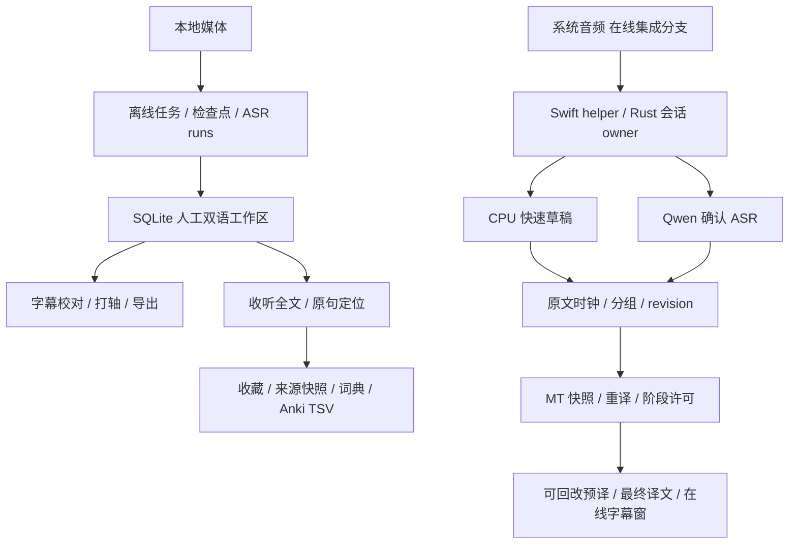

# 系统结构、在线瓶颈与同类工具回顾

日期：2026-11-11。状态：只读代码调查、文档整理与设计讨论材料；建议未视为已批准实施。外部资料为当日官方文档／上游 README，未安装或实测竞品，不引用宣传延迟作为 Atogaki 的性能保证。

## 需求与初步结论

用户确认在线用于直播／电台理解，允许几秒到十几秒延迟，优先语义和内容正确。低延迟错译会主动破坏语境理解，较晚但正确的翻译更有价值；已有正确草稿被错误定稿替换也属于退化。因此不能只优化首字、平均 HTTP 耗时或最终提交速度。

现有证据同时指向输入错误、模型理解／上下文隔离和等待／调度；尚不能把问题归结为本机算力不足，也不能断言整条 pipeline 已到上限。离线闭环已经成立，在线还没有可靠的质量结论，学习区则已有可复用的数据基础、缺少长期使用验证。

建议继续把产品看作围绕媒体、可信双语时间轴和来源的一个工作台：文件导入与直播采集有各自处理策略，回看／编辑／学习共享资料来源。此为结构建议；可选录音、会后精修、在线晋升主线、内建复习等均未因本次回顾自动批准。

## 审阅范围与分支事实

| 分支／基线 | 核对内容 | 不能推导的结论 |
| --- | --- | --- |
| main `cf23b87` | v0.1.3 离线、编辑、收听、学习；本次工作区从此创建文档分支 | 不包含在线 worker，不代表用户本机没有在线开发版 |
| online-asr-experiments `11d2847` | 实验脚本、双模型路线及研究历史 | 旧模型矩阵不是当前必做清单 |
| online-desktop-integration `e06a9c6` | Swift 系统采集、Rust 会话、Python worker、在线 UI；截至 11 月 11 日的调度与提示排查记录 | 试装不是稳定发行，结构回归不是语义验收 |

两个在线工作区审阅时均无未提交改动。本轮仅在当前独立文档分支写入，不合并其他分支、不修改其文档、不更新 App、不运行模型或云端请求。集成分支文档记录 `aa6bd89` runtime 已随后覆盖本机，ADR 0076 和计划末尾仍保留“未覆盖安装”的阶段描述；这是需按最新执行记录阅读的状态冲突，本轮没有跨工作区改写它们。

在线证据固定到[集成分支评测 e06a9c6](https://github.com/chai-yinfeng/Atogaki_Subtitle/blob/e06a9c6/docs/evaluation.md)、[0076](https://github.com/chai-yinfeng/Atogaki_Subtitle/blob/e06a9c6/docs/decisions/0076-source-driven-retranslation-and-stage-admission.md)及[计划](https://github.com/chai-yinfeng/Atogaki_Subtitle/blob/e06a9c6/docs/online-asr-plan.md)。这些是仓库内已有记录，本轮未重新执行或独立复算私有原始结果。

## 当前系统结构与维护问题



离线的 run／artifact 与人工工作区隔离、revision 保护、来源和学习快照有实际价值，应继续保留。识别、翻译、编辑、打轴、导出组合并不反常；它们围绕同一媒体和时间轴，问题是各自的正确性与状态是否清楚。学习区已有收藏／多来源／词典／检索／文本 Anki，不宜描述成从零未做。

在线同样已有较明确的进程边界：Rust 拥有会话与生命周期，Swift 采集，Python 拥有模型调用和重译状态，UI 消费事件／展示状态。CPU 草稿、Qwen 确认、翻译组、可见字幕各有时间和版本；设备阶段许可不等于语义提交资格。跨语言并非自动构成坏架构，但增加打包、错误传播、时钟和停止边界的维护成本。

[worker.py](https://github.com/chai-yinfeng/Atogaki_Subtitle/blob/e06a9c6/src/infrastructure/online_worker/worker.py) 已拆分 Qwen／MT 线程；[stage_admission.py](https://github.com/chai-yinfeng/Atogaki_Subtitle/blob/e06a9c6/src/infrastructure/online_worker/stage_admission.py) 默认任务级交错、各一在途；[retranslation.py](https://github.com/chai-yinfeng/Atogaki_Subtitle/blob/e06a9c6/src/infrastructure/online_worker/retranslation.py) 根据原文／时钟确定范围、冻结请求、管理缓存与提交；[mt.py](https://github.com/chai-yinfeng/Atogaki_Subtitle/blob/e06a9c6/src/infrastructure/online_worker/mt.py) 仍为完整请求返回后校验。这些已落地的边界不应再次写成“下一步先异步化”或“把分组从取任务移出”的新提案。

仍值得讨论的维护点：

- 主线仍默认携带早期 Web／Postgres 依赖；桌面 loopback 媒体服务独立且必须保留。已有[退役分析](legacy-web-retirement-impact.md)，本次不擅自加 feature 或删 API。
- 主线 `ui/src/main.ts` 4,934 行、`local_db.rs` 3,837 行、`local_workspace_service.rs` 2,540 行、`local_task_service.rs` 2,514 行；均为整文件计数，含相应内联测试。说明协调仍集中，不能直接证明耦合错误或性能问题。
- 跨分支与长篇执行流水让“实现／试装／已发布／质量通过”混为一谈，旧提案会重新生成待办。本轮重写当前入口并归档；在线分支同类文档需后续在该分支收敛。

## Graphify 实际能回答什么

本机存在 `~/.local/bin/graphify`。当前会话无 Graphify tool；检查本地 MCP 配置也未发现其 server。已使用 CLI，不把 CLI 调用表述为 MCP 已连接。

[Graphify 上游说明](https://github.com/Graphify-Labs/graphify)支持代码 AST、可选文档语义提取、社区聚类、路径／影响查询和架构／call-flow 导出。因此它不局限于函数细节，适合观察模块依赖与中心节点。文档语义与社区命名需要另行启用，本轮不调用外部模型。

实际命令：

```sh
graphify extract /path/to/online-integration-worktree \
  --code-only --no-cluster --cargo --max-workers 2 \
  --out /tmp/atogaki-design-review-20261111
graphify god-nodes --top 12 \
  --graph /tmp/atogaki-design-review-20261111/graphify-out/graph.json
graphify export callflow-html \
  --graph /tmp/atogaki-design-review-20261111/graphify-out/graph.json \
  --output /tmp/atogaki-design-review-20261111/architecture.html \
  --lang zh-CN --max-sections 8
```

本次扫描 491 份代码文件，得到 4,829 节点／12,265 边。高连接节点包括 DesktopState、LocalDatabase（各 117 边）、TranslationProvider（66）、Retranslation（51）。它们是调用／类型使用的排查入口，不是“坏设计排名”。

限制：缺少 `tree_sitter_sql`，31 份 SQL 未贡献图；26 份文件无符号；Cargo 补充仅产出 1 节点／0 边，不能当完整 crate 依赖图。纯代码模式跳过 163 份非代码输入，没有文档语义或社区聚类。跨进程 stdin／JSON／IPC／HTTP 的业务关联、状态所有权、时间依赖与资源竞争仍需人工核对；AST 图不能证明延迟瓶颈或最合适的产品划分。产物留临时目录，不提交图、媒体或源码副本。

## 正确率与延迟：已有证据如何解释

11 月 11 日固定 radio-06、180 秒回放，M4／24 GiB，SenseVoice CPU 草稿＋Qwen3-ASR 1.7B FP16 MLX＋Index-Translate 2B Q4_K_M Metal；每臂重启服务，交错后并发，各运行一次，排除模型加载。

| 已有观测 | 任务交错 | ASR／MT 各一任务并发 |
| --- | ---: | ---: |
| ASR 排队 P95 | 2.583 s | 1.030 s |
| ASR 计算 P95 | 2.023 s | 2.898 s |
| MT 调用 P95（含缓存） | 1.077 s | 1.576 s |
| 最终 MT 返回距自身组尾 P95 | 11.987 s | 12.785 s |
| MT 执行任务／草稿返回 | 150／130 | 158／138 |
| 最终源段／译文组 | 36／19 | 36／19 |

这是单素材单次顺序对照，19 组 P95 落在最大值；不是统计显著性或真实桌面 E2E。仍足以反驳“开启并发就已经改善最终译文等待”的说法。并发减少排队，同时单次推理变慢，提示共享设备存在资源竞争，不能据此定量归因 GPU kernel。

更关键的是两臂相同三处后验局部事实仅保留一处，含历史替代当前内容和比较反向；对应最终源文已基本包含关键事实，不能全部归咎 ASR。后续冷服务、前序请求、关闭前缀缓存的固定请求诊断仍复现错误，证明这些错误不需要旧请求残留状态。它没有证明所有缓存均无影响，也没有证明换大模型无用。

11 月 9 日五段回放的 14 个锚点中，7 处事实曾正确可见、最终仅 5 处保留，说明“更晚的定稿”可能退化。它们是已曝光难例的后验局部评审，不是全片准确率。另有同版本 Q4／F16 固定请求比较，真实难点均 5/14，说明升精度未在该实验中稳定解决问题；不能推广为所有量化无影响。

由此区分四类空间：

1. **输入。** ASR 已漏掉、认错的事实，普通 MT 无法可靠补回；须比较在线源文与核准参考。
2. **模型与输入合同。** 固定正确源文仍翻反或串历史，增加算力、缩队列无法直接修复；应先查当前源范围、参考组织、模型本身。
3. **等待策略。** 完整音频、停顿、确认、语义组 ready 都会等待。`组尾→返回`遗漏组内第一处事实已等的时间；更长上下文可能改善消歧，也可能导致串译。
4. **计算与展示。** 重复预译、排队、共享设备竞争、完整返回才上屏都有成本；已有结构回放不包含真实 IPC／绘制。改变解码／SSE可能缩短首字，却未必让正确内容更早可读。

## 同类产品与开源路线

| 参考对象 | 官方已描述的能力／设计 | 对本项目的启示与边界 |
| --- | --- | --- |
| [Subtitle Edit](https://subtitleedit.github.io/subtitleedit/) | 字幕表格、编辑、波形、语音转写、翻译、校时、格式与烧录整合 | 识别→翻译→编辑／打轴→导出的一体化有成熟参照；不因此承诺补齐完整 ASS 制作功能 |
| [VideoLingo](https://github.com/Huanshere/VideoLingo) | 转录／对齐、术语、翻译、字幕切分、可选配音；当前默认 Qwen3-ASR＋ForcedAligner，支持恢复 | 语义翻译与最终字幕排版可分阶段；其离线完整上下文不能直接用于直播等待预算，不宣称它的译文比本项目更准 |
| [Buzz](https://github.com/chidiwilliams/buzz) | 本地文件转录、多后端、实时麦克风转录、展示窗、字幕导出 | 借鉴轻量实时入口；其[录音文档](https://github.com/chidiwilliams/buzz/blob/main/docs/docs/usage/2_live_recording.md)的 Whisper translate 任务是译成英语，不能当现成日中低延迟翻译方案 |
| [WhisperLiveKit](https://github.com/QuentinFuxa/WhisperLiveKit) | 流式 ASR、展示／协议适配、NLLB 或独立 AlignAtt MT；支持不同后端 | 借鉴清晰的稳定／未稳定文本与 ASR／MT 服务边界；支持某语言 ASR 不等于同方向翻译已经校准 |
| [SimulStreaming](https://github.com/ufal/SimulStreaming) | Whisper＋EuroLLM 级联，AlignAtt／LocalAgreement，确认前缀与可回改尾部；主要优化 1–2 GPU 场景 | 比反复整组自由重译更接近专门同传策略，但语言、硬件和质量须重新核对；不能拿服务器数字外推 M4 日中体验 |
| [Moonshine](https://github.com/moonshine-ai/moonshine/blob/main/docs/models/available-models.md) | 当前官方表列日语 Small／Tiny Streaming，韩语仍无 streaming checkpoint；指标和许可证按模型区分 | 是本轮新发现的低成本日语草稿候选，未测试；不将其 CER 与 Qwen／Whisper 的不同数据集 WER 排名，也不立即替换现有草稿 |
| [Language Reactor](https://www.languagereactor.com/help/export) | 官方导出帮助描述带例句收藏及 Anki 导出；本轮页面正文依赖 JS，相关细节仅由官方搜索摘要确认 | 学习入口应保留原句语境；不将未读取到的音频／本地文件能力计为已核验 |
| [Migaku](https://migaku.com/) | 在字幕／网页查词，从原内容制作含例句、音频、截图等卡片，间隔复习 | 学习价值来自“遇到→收藏→再遇到／复习”的闭环；完整 SRS、内容推荐和账号生态是额外产品，不必一并重做 |

本轮特别核对了两个容易误选的新方案：[Qwen3-ASR-causal](https://github.com/QuentinFuxa/Qwen3-ASR-causal) 的 causal tower 官方明确仅适用于英语，多语应使用 windowed 后端，不能直接解决日语实时问题。[WhisperLiveKit 的 MLX AlignAtt 校准](https://github.com/QuentinFuxa/WhisperLiveKit/blob/main/docs/simul_mt_calibration.md)当前随包为 Hy-MT2 1.8B 8bit **英→中**，要求精确匹配模型版本、量化、语言方向和 prompt；不是现成日→中替代。whisper.cpp 的 [stream 示例](https://github.com/ggml-org/whisper.cpp/tree/master/examples/stream)则自称简易演示，不包含完整的可靠译文提交策略。

这些资料证明还有不同技术路线可研究，没有证明其中任一方案已同时解决本机日中直播的正确性和延迟。本轮不下载新权重或并排跑多套推理。

## 建议下一轮如何决策

先用现有固定素材和人工事实锚点做有界分析，不重新建立一大套重复工程测试。模型／输入合同候选必须先保留否定、比较、主体、因果与当前待译范围，再讨论等待时间；纯结构通过不足以晋升。

建议对同一批内容依次区分：当前在线 ASR→当前 MT；核准源文→相同 MT；相同固定源文／上下文→一个较强翻译参考。最后一项若需云端、费用或新增模型，另行明确，不使用事后参考作为生产输入。这个设计可分别暴露 ASR、MT 和在线等待的损失；参考也需人工核准，不能把大模型当 gold。

延迟报告同时保留首次正确可读、最终提交、正确后退化、未完成／失败与队列年龄。正确输出的条件延迟必须同时给出正确覆盖率，不能只统计成功句子来显得更快。当前允许数秒到十几秒；具体 P95 门槛和允许误译率尚未冻结，不能凭该范围宣布已达标。

产品上建议维持离线可靠闭环；在线先验证稍晚、少误导、连续可读是否成立；学习先从已有收藏／原句回放和文本 Anki 的使用痛点收敛。是否减少预译、更保守提交、换 MT、改原生流式 ASR、启用录音后精修或新增音频导出，均留待讨论。每当在线获得可信对照、学习完成一轮使用反馈或发行前，再回顾一次需求与同类工具；暂不创建定时自动化。
